# Введение

## О чём этот документ

Это подробное описание архитектуры решения **DashSpec** — платформы, в которой отчёты и дашборды описываются **обычным текстом в git**, а не собираются мышкой в закрытом визуальном редакторе.

Документ рассчитан на **широкую аудиторию**: руководителей продукта, аналитиков, технических писателей, а также инженеров, которым нужно понять систему целиком. Для этого:

* все термины объясняются на бытовом языке и сведены в глоссарий (§18);
* каждая диаграмма сопровождается текстовым пояснением;
* «что происходит на самом деле» описывается через картинки и последовательности шагов, а не через код;
* честно названы сильные и слабые стороны архитектуры (разделы 14 и 15), включая технический долг.

Документ построен по **современным нотациям описания архитектуры**:

| Нотация | Что показывает | Где в документе |
|---------|----------------|-----------------|
| **C4 модель — уровень 1 (контекст)** | Система и её окружение | §2, диаграмма 1 |
| **C4 модель — уровень 2 (контейнеры)** | Из каких крупных частей состоит система | §3, диаграмма 2 |
| **C4 модель — уровень 3 (компоненты)** | Из чего состоят части внутри | §4–§5 |
| **Диаграмма слоёв** | Правила зависимостей между частями | §4, диаграмма 3 |
| **Граф зависимостей проектов** | Что от чего зависит в коде | §4.7, диаграммы 4a–4b |
| **Диаграмма конвейера (pipeline)** | Как текст превращается в экран | §7, диаграммы 5a–5b |
| **Диаграмма потоков данных** | Как данные идут от базы до карточки | §8, диаграммы 6–7 |
| **Диаграмма последовательности** | Кто с кем общается во времени | §8.5, диаграмма 8 |
| **Диаграмма семейств плагинов** | Точки расширения | §10, диаграмма 9 |
| **Реестр разрешений** | Кто «побеждает» при конфликте настроек | §7.4, диаграмма 10 |
| **Диаграмма развёртывания** | Что и где работает в проде | §11, диаграмма 11 |
| **Диаграмма контура качества** | Какие проверки защищают архитектуру | §12, диаграмма 12 |

> Все диаграммы — **картинки**, сгенерированные из исходников Mermaid (`docs/architecture/diagrams/*.mmd`).
> Скрипт пересборки: `docs/architecture/render-diagrams.py`. Рядом лежат и SVG-версии для чтения в браузере.

**Содержание**

## Как читать документ непрограммисту

Если вы не пишете код, читайте так:

1. §1 — что это и зачем (аналогия с «исходным кодом и компилятором»).
2. §2–§3 — общая картина и состав системы (две картинки).
3. §7 — как текст превращается в экран.
4. §8 — откуда берутся данные и почему это безопасно.
5. §14–§16 — что хорошо, что плохо и куда всё идёт.
6. §18 — глоссарий, если встретилось незнакомое слово.

Разделы §4–§6, §9–§13 — более технические, их можно пропустить при первом чтении.

# 1. Что такое DashSpec — объяснение «на пальцах»

## 1.1 Проблема, которую решает система

Сегодня корпоративная отчётность обычно живёт в одном из трёх миров:

| Мир | Как выглядит | Чем плох |
|-----|--------------|----------|
| **Ручной** | Аналитик каждый раз пишет SQL и присылает выгрузку | Не воспроизводится, не проверяется, знания уходят вместе с человеком |
| **Визуальный редактор** | Дашборд собирают мышкой; результат — бинарный файл в базе BI-инструмента | Невозможно нормально сравнивать версии, ревьюить, разбирать конфликты, искать текст |
| **Самописный код** | Команда пишет приложение с графиками | Дорого, каждый отчёт — мини-проект |

DashSpec выбирает **четвёртый путь**.

## 1.2 Идея DashSpec в одном абзаце

**Описание отчёта — это текст.** Спецификация дашборда, описание диаграмм, раскладка карточек, палитра, типы строк, поток преобразования данных и каталог отчётов — всё это обычные текстовые файлы в git-репозитории. Их можно читать глазами, сравнивать построчно, ревьюить в pull request, комментировать и откатывать.

Дальше в дело вступает **платформа**: она разбирает текст, проверяет его на ошибки, собирает из него «эффективную модель» отчёта, превращает фильтры в параметризованный SQL, получает из базы данных типизированные строки, считает данные для карточек и отдаёт их **вьюеру** — тому, что рисует пиксели (веб-браузер сегодня, desktop-редактор или стороннее приложение — завтра).

## 1.3 Аналогия для непрограммистов

Сравните с обычным программированием:

| Обычный софт | DashSpec |
|--------------|----------|
| Исходный код (`.cs`, `.py`) | Спецификации отчётов (`.ds`) |
| Компилятор, проверяющий код | Компилятор языка DashSpec (разбор, проверки, диагностика) |
| Приложение, которое запускается | Сессия отчёта: фильтры, данные, карточки |
| Операционная система и драйверы | Коннекторы к базам данных и плагины |
| Разные окна одной программы | Разные вьюеры: веб, desktop, встраивание |

**Ключевое слово — «git-native»**: источником истины является текст в системе контроля версий, а не внутренняя база данных инструмента. Это даёт то, что BI-инструменты обычно не умеют: историю, ревью, диффы, автоматические проверки и полноценную работу инженерных агентов.

## 1.4 Кто пользуется системой

| Роль | Что делает | Что ей важно |
|------|-----------|--------------|
| **Автор отчёта** (аналитик, инженер данных) | Пишет `.ds` в git, подключает представления БД, настраивает фильтры | Быстрая обратная связь, диагностика, предсказуемость |
| **Зритель** (стейкхолдер, руководитель) | Открывает ссылку, переключает отчёты, кликает по графикам | Ничего не настраивать, всё работает в браузере |
| **Инженер платформы** | Пишет коннекторы, плагины визуализации, виджеты фильтров | Стабильный контракт (SDK), тесты, независимость версий |
| **Администратор** | Разворачивает сервис, ведёт ключи доступа, следит за каталогом | Простое развёртывание, безопасность, обновления из git |

# 2. Контекст системы (C4, уровень 1)

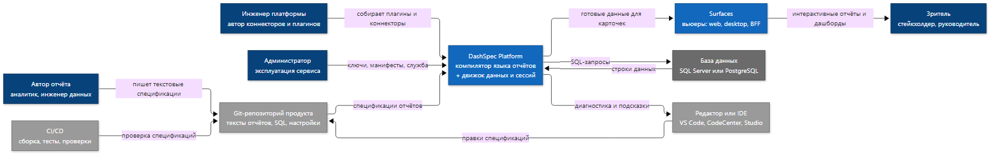

*Диаграмма 1 — контекст DashSpec. Источник: [`01-context.mmd`](architecture/diagrams/01-context.mmd).*

Диаграмма отвечает на вопрос «что находится вокруг системы».

* **Автор отчёта** пишет спецификации не в интерфейсе платформы, а в git-репозиторий своего продукта.
* **Зритель** получает уже готовый интерактивный отчёт через вьюер (сегодня — веб-страница).
* **Инженер платформы** добавляет возможности: новый коннектор, новый тип диаграммы, новый виджет фильтра.
* **Администратор** отвечает за эксплуатацию: манифесты, ключи доступа, службу, синхронизацию каталога.
* Внешние системы: **git-репозиторий** (источник истины), **база данных** (данные), **редактор/IDE** (авторинг с подсказками), **CI** (автоматические проверки).

Важное следствие: **платформа не является редактором отчётов**. Редактор — это VS Code, CodeCenter или будущий Studio. Платформа — это компилятор плюс движок исполнения плюс вьюер.

# 3. Контейнеры системы (C4, уровень 2)

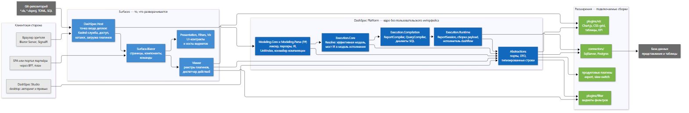

*Диаграмма 2 — крупные части системы. Источник: [`02-containers.mmd`](architecture/diagrams/02-containers.mmd).*

| Контейнер | Роль | Разворачивается отдельно? |
|-----------|------|---------------------------|
| `DashSpec.Host` | Точка входа деплоя: веб-служба, доступ, каталог, загрузка плагинов | **Да** — это и есть «приложение» |
| `DashSpec.Surface.Blazor` | Страницы, компоненты, команды потребления (то, что видит зритель) | Нет, часть деплоя |
| `DashSpec.Viewer` | Реестры плагинов: визуализации, виджеты фильтров, обработчики действий | Нет, часть деплоя |
| `DashSpec.Presentation`, `DashSpec.Filters`, `DashSpec.Viz` | Общие UI-контракты и хосты виджетов | Нет, библиотеки |
| `DashSpec.Modeling.Core`, `DashSpec.Modeling.Parse` (F#) | Язык: разбор, IR, компиляция документа | Нет, библиотеки ядра |
| `DashSpec.Execution.Core` | «Разрешение»: превращение IR в эффективную модель | Нет |
| `DashSpec.Execution.Compilation` | Компиляция отчёта и SQL-запросов, диалекты | Нет |
| `DashSpec.Execution.Runtime` | Сессия отчёта, сборка данных карточек, исполнение потоков | Нет |
| `DashSpec.Abstractions` | Контракты: порты, DTO, типизированные строки | Нет |
| `connectors/`, `plugins/` | Подключаемые сборки: базы данных, визуализации, виджеты | **Да** (DLL + манифест) |

Главный архитектурный вывод из уровня 2: **в системе только один исполняемый деплой — Host, и он тонкий**. Вся предметная логика находится в библиотеках платформы, которые не знают о том, что их показывает Blazor.

# 4. Компоненты (C4, уровень 3)

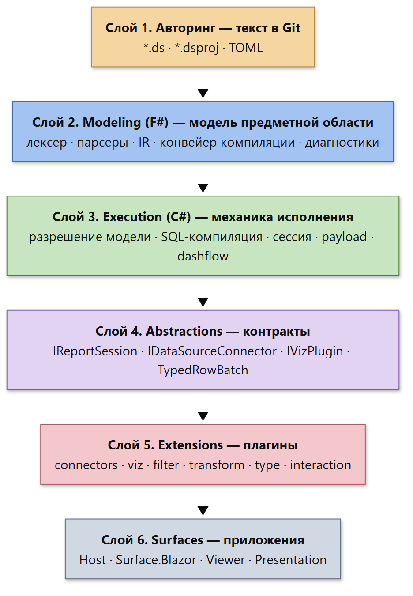

*Диаграмма 3 — шесть слоёв и направление зависимостей. Источник: [`03-layers.mmd`](architecture/diagrams/03-layers.mmd).*

## 4.1 Слой 1 — авторинг (текст)

| Что | Где | Смысл |
|-----|-----|-------|
| Единицы компиляции | `*.ds` | Один файл = одна единица: `module dashboard demo_soak`, `module diagram peak_heatmap`, `module flow report_flow` и т. д. |
| Проект | `*.dsproj` | Состав пакета: корневой namespace, корни поиска, перечень файлов |
| Окружение | TOML | Подключения к БД, таймауты, лимиты строк, список загружаемых плагинов |

Особенность, к которой стоит привыкнуть: **вид единицы определяется её содержимым, а не расширением файла**. Расширение `.ds` одно для всех видов; что это — отчёт, диаграмма, раскладка или тип строк — говорит ключевое слово `module <вид> <идентификатор>` в первой строке.

## 4.2 Слой 2 — Modeling (F#): «модель мира»

Это языковая часть. Здесь живёт всё, что связано со смыслом текста.

| Компонент | Что делает |
|-----------|-----------|
| **Lexing и Syntax** | Режет текст на токены, знает позиции символов (строки и колонки) |
| **Парсеры единиц** | Отдельный парсер на каждый вид: отчёт, вкладка, диаграмма, раскладка, презентация, подсказка, палитра, типы, поток, каталог, оболочка хоста |
| **UnitIndex** | Один проход по файлам: читает заголовки (`namespace`, вид единицы) и строит индекс для `import` |
| **IR (промежуточное представление)** | Структуры данных, описывающие документ без привязки к способу отображения |
| **Типы и их законы** | Система типов строк, правила совместимости, календарные и часовые преобразования |
| **Графы** | Граф потока данных (dashflow) и граф проводки (wiring graph) |
| **Конвейер компиляции документа** | Единый оркестратор пост-разбора (§7.2) |
| **Диагностики** | Ошибки и предупреждения с кодом, позицией и понятным текстом |

Почему именно **F#** для этого слоя? Потому что разбор языка, алгебраические типы и графы — это «жёсткая модель»: здесь выигрывает язык с сопоставлением с образцом и невозможностью «забыть вариант». Это зафиксировано отдельным решением (ADR-0051: определение языка по природе задачи) и повторяет практику родственных проектов федерации.

## 4.3 Слой 3 — Execution (C#): «механика»

| Компонент | Что делает |
|-----------|-----------|
| **Execution.Core** | «Разрешение»: собрать эффективную модель, применить библиотеку отчёта, свести мост из IR в модель исполнения |
| **Execution.Compilation** | Компилятор отчёта и компилятор запросов: из объявлений фильтров и привязок получается параметризованный SQL; диалекты T-SQL, PostgreSQL, generic |
| **Execution.Runtime** | Сессия отчёта, состояние фильтров, сборка данных для карточек (chart/table/matrix/scalar), исполнитель dashflow, разрешение карточек и диаграмм |

Ключевое правило: **Execution никогда не разбирает текст сам**. Любой повторный разбор — только через Modeling. Это исключает появление «второго парсера», который начнёт расходиться с первым.

## 4.4 Слой 4 — Abstractions: контракты

Единственное место, которое видят авторы плагинов:

* порты подключения к данным (`IDataSourceConnector`, `IConnectorPlugin`);
* модель запроса (`CompiledQuery`) и диалектов;
* порты сессии отчёта (`IReportSession` — в проекте `Viz`, `IReportPreviewSession` — в `Abstractions`);
* визуализации (`IVizPlugin`) и виджеты фильтров;
* плагины и их возможности (`IDashSpecPlugin`, `IDashSpecContributorRegistry`, `PluginTier`, манифест);
* данные на «проводе» (`TypedRowBatch`, `DashValue`, схема строки).

Всё остальное — внутренняя реализация и может меняться без предупреждения. Это осознанная граница: SDK обещает стабильность, внутренности — нет.

## 4.5 Слой 5 — Extensions: плагины

См. §10. Кратко: коннекторы, визуализации, виджеты фильтров, шаги преобразования данных, семантические типы, обработчики взаимодействий.

## 4.6 Слой 6 — Surfaces: то, что разворачивают

| Surface | Статус | Кому |
|---------|--------|------|
| Web (Blazor) | **работает** | зрителям: браузер, фильтры, срезы, командная строка |
| Studio (desktop) | проектируется | авторам: дерево спецификаций, редактор раскладки, превью отчёта |
| BFF (HTTP/OpenAPI) | спроектирован, не начат | сторонним разработчикам: SPA, порталы, встраивание |

## 4.7 Карта проектов и реальных зависимостей

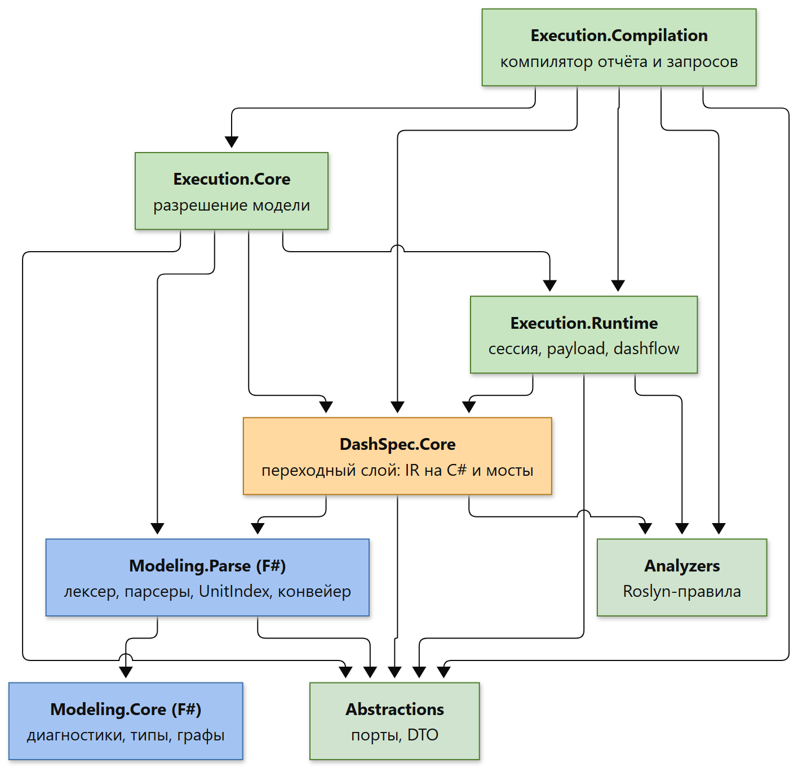

*Диаграмма 4a — ствол платформы: язык, разрешение, исполнение. Стрелка означает «зависит от». Источник: [`04a-spine.mmd`](architecture/diagrams/04a-spine.mmd).*

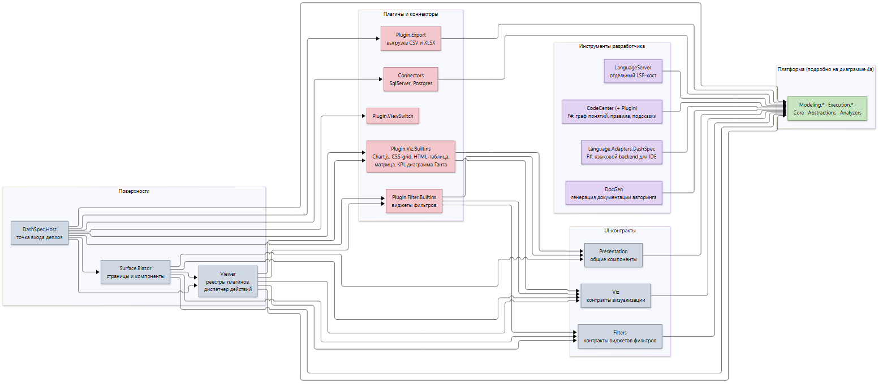

*Диаграмма 4b — поверхности, UI-контракты, плагины и инструменты. Источник: [`04b-surfaces.mmd`](architecture/diagrams/04b-surfaces.mmd).*

| Проект | Роль | Зависит от |
|--------|------|------------|
| `Modeling.Core` (F#) | Диагностики, система типов, графы, законы | — |
| `Modeling.Parse` (F#) | Лексер, парсеры, индекс единиц, конвейер компиляции | `Modeling.Core`, `Abstractions` |
| `Core` (C#) | **Переходный слой**: IR-записи и мосты к F#-парсеру | `Modeling.Parse`, `Abstractions`, `Analyzers` |
| `Execution.Runtime` | Сессия, сборка данных карточек, исполнитель потоков | `Core`, `Abstractions`, `Analyzers` |
| `Execution.Core` | Разрешение модели, мост IR в модель исполнения | `Execution.Runtime`, `Core`, `Modeling.Parse`, `Abstractions` |
| `Execution.Compilation` | Компилятор отчёта и запросов, диалекты SQL | `Execution.Core`, `Execution.Runtime`, `Core`, `Abstractions`, `Analyzers` |
| `Abstractions` | Порты и DTO для плагинов | — |
| `Analyzers` | Roslyn-правила архитектуры | — |
| `Viz`, `Filters`, `Presentation` | Контракты визуализаций, фильтров, общие компоненты | `Core`, `Execution.Runtime` |
| `Viewer` | Реестры плагинов и диспетчер действий | `Viz`, `Filters`, встроенные плагины |
| `Surface.Blazor` | Страницы и компоненты вьюера | `Viewer`, UI-контракты, платформа |
| `Host` | Точка входа деплоя | `Surface.Blazor`, `Viewer`, коннекторы, плагины |
| `LanguageServer`, `DocGen` | Инструменты разработчика | `Core` |
| `CodeCenter`, `Language.Adapters.DashSpec` (F#) | Интеграция с IDE и языковым сервисом | `Modeling.*`, `Execution.Core` |
| `connectors/*`, `plugins/*` | Подключаемые сборки | `Abstractions` (+ платформенные библиотеки у встроенных) |

Что видно на диаграммах:

1. **Ядро языка стоит в основании** — `Modeling.Core` не зависит ни от чего, кроме стандартной библиотеки F#.
2. **`DashSpec.Core` — переходный слой** (выделен цветом): исторически он был «всем», сейчас в нём остались IR-записи на C# и мосты к F#-парсеру. Его планируется растворить между `Execution.*` и `Modeling.*`; этапы удаления дублирующих парсеров уже пройдены.
3. **`Execution.Compilation` — самая связная точка**: он зависит от `Execution.Core`, `Execution.Runtime` и `Core` одновременно. Это узкое место для параллельной разработки (см. §15.4).
4. **Плагины не зависят от `Host`** — только от платформенных библиотек и контрактов. Именно это делает возможной вторую поверхность без форка ядра.

# 5. Правила, которые держат архитектуру

Архитектура без правил быстро превращается в «большой клубок». Здесь правила закреплены **автоматически**, а не на словах.

| Правило | Формулировка | Чем проверяется |
|---------|--------------|-----------------|
| **Направление зависимостей** | Стрелки идут только вниз: Surfaces → Execution → Modeling. Обратных зависимостей нет | Тесты архитектуры (NetArchTest) |
| **Host — тонкая оболочка** | Host не содержит бизнес-логики: ни расчёта данных, ни форматов дат, ни навигационных догадок | Анализаторы `DSCHOST001–003` + source guards |
| **SQL только в коннекторах** | Типы SQL-клиентов запрещены вне `connectors/**` | Анализатор `DSPEC020` |
| **Никакого ввода-вывода в Runtime** | Файлы, процессы, HTTP запрещены в `Execution.Runtime` | Анализатор `DSPEC021` |
| **Типизированные данные на проводе** | Словари «строка → что угодно» и `object` в ячейках запрещены | Анализаторы `DSPEC030–034` |
| **Платформа без ASP.NET** | Проекты платформы не ссылаются на ASP.NET и на Host | Анализатор + тесты архитектуры |
| **Совпадение генерируемого каталога** | Сгенерированный файл каталога должен совпадать с результатом генератора | Drift gate в сборке |

Предупреждения в этом репозитории считаются **ошибками** (`TreatWarningsAsErrors`). Это значит: нарушение правила ломает сборку, а не «копится до лучших времён».

# 6. Язык спецификаций

## 6.1 Единый вид файла и явный заголовок

```text
module dashboard demo_soak
    import diagrams from Demo.Diagrams
    import types from Demo.Types
    namespace Demo.Soak

    runtime
        manifest = "demo.toml"
    end runtime

    report
        title = "Demo soak"
        ...
    end report
end dashboard
```

Что здесь важно для непрограммиста:

* `module dashboard demo_soak` — «это единица вида *отчёт*, её имя `demo_soak`».
* `namespace Demo.Soak` — логическое имя единицы, по нему её находят другие файлы.
* `import diagrams from Demo.Diagrams` — «возьми все диаграммы из набора `Demo.Diagrams`». Импорт указывает **вид** символов (`diagrams`, `layouts`, `flows`, `types`, `palettes`, …), а не путь к файлу.
* `runtime` — окружение (файл с подключениями). Секреты в спецификацию не попадают.
* `report` — собственно отчёт: фильтры, панели, вкладки, карточки.

## 6.2 Виды единиц

| Вид (`module <вид>`) | Что описывает |
|----------------------|---------------|
| `dashboard` | Отчёт: фильтры, вкладки, карточки, потоки |
| `tab` | Вкладка отчёта, вынесенная в отдельный файл |
| `diagram` | Заготовка диаграммы (тип, привязки, оформление) |
| `layout` | Схема расположения карточек или фильтров |
| `presentation` | Пресет оформления области графика |
| `tooltip` | Всплывающая подсказка |
| `palette` | Набор цветов серий |
| `types` | Типы строк данных |
| `flow` | Поток данных: источники, преобразования, связи |
| `catalog` | Каталог отчётов (то, что видит зритель в списке) |
| `host` | Оболочка продукта: заголовок, тема, ссылки, часовой пояс |

Исторические расширения (`.dashspec`, `.dashdiagram`, `.dashlayout`, …) ещё читаются для совместимости, но новые спецификации используют единый `.ds`, а вид определяется заголовком (ADR-0101).

## 6.3 Импорт вместо «вставки файла»

Раньше файлы «склеивались» директивой `!include` — как в старых языках до появления модулей. Это давало эффект «одна сломанная диаграмма в папке ломает весь отчёт», потому что подключались все файлы по маске разом.

Сейчас модель как в нормальном языке программирования:

1. **Проект** (`*.dsproj`) или корни поиска определяют, какие файлы вообще существуют.
2. **Заголовок единицы** объявляет `namespace`.
3. **Потребитель** пишет `import <вид> from <Пространство> [as псевдоним]`.
4. Компилятор строит **индекс**: один проход по заголовкам, затем выборка нужных единиц.

Результат: неудачный черновик в папке больше не ломает сборку отчёта, а список зависимостей отчёта виден глазами.

# 7. Жизненный цикл: от текста до экрана

## 7.1 Общая картина

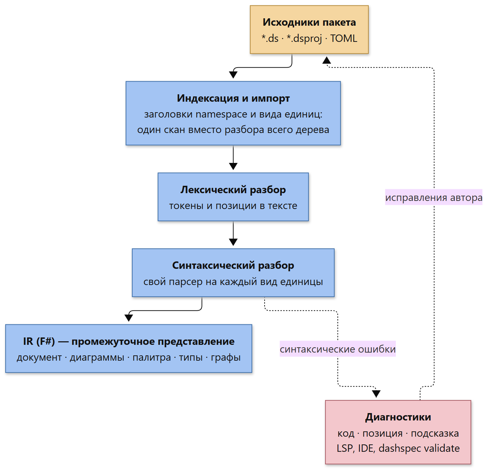

*Диаграмма 5a — от текстовых файлов до промежуточного представления. Источник: [`05a-parse.mmd`](architecture/diagrams/05a-parse.mmd).*

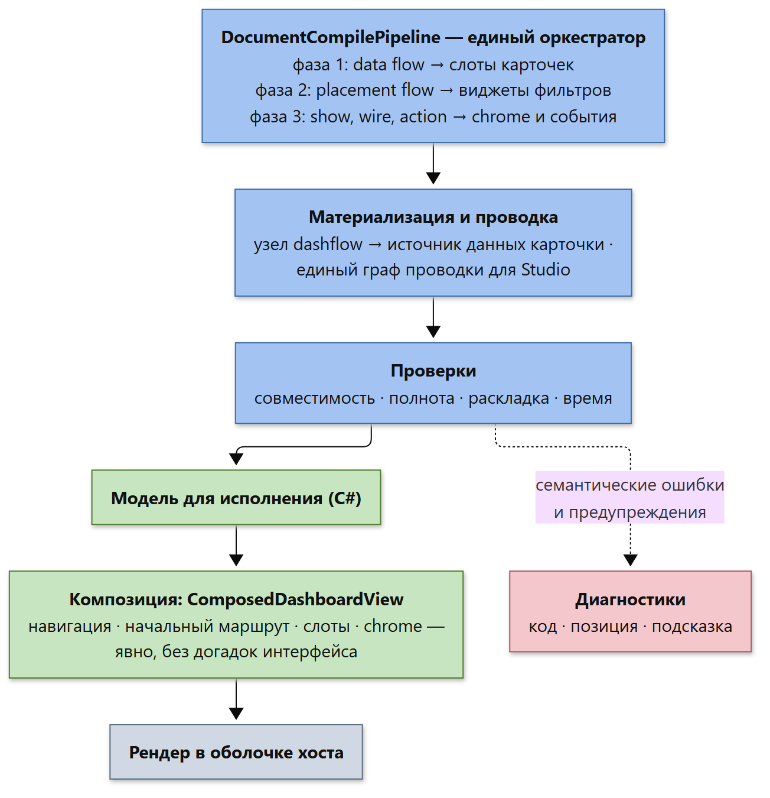

*Диаграмма 5b — от IR до экрана. Источник: [`05b-compile.mmd`](architecture/diagrams/05b-compile.mmd).*

## 7.2 Стадии конвейера

| № | Стадия | Что происходит | Кто отвечает |
|---|--------|----------------|--------------|
| 1 | **Индексация** | Один проход по файлам: читаются заголовки, строится индекс «пространство имён + вид единицы» | `UnitIndex` (F#) |
| 2 | **Разрешение импортов** | Из индекса выбираются только нужные единицы нужных видов | `ModuleImportResolver` (F#) |
| 3 | **Лексический разбор** | Текст превращается в токены, запоминаются позиции | Lexing (F#) |
| 4 | **Синтаксический разбор** | Токены превращаются в структуру; у каждого вида единицы свой парсер | Парсеры (F#) |
| 5 | **Построение IR** | Собирается единый документ: отчёт, связанные диаграммы, палитра, типы, графы | IR (F#) |
| 6 | **Конвейер компиляции документа** | Единый оркестратор применяет фазы (см. ниже) | `DocumentCompilePipeline` (F#) |
| 6.1 | → **data flow** | Потоки данных отчёта и страницы направляются в **слоты** карточек | `ReportScopeDataFlowApplicator` |
| 6.2 | → **placement flow** | Определяется, где появляются виджеты фильтров (отчёт, страница, карточка) | `ReportScopePlacementApplicator` |
| 6.3 | → **show / wire / action** | Оформление (chrome), события, привязки | `ReportScopeFlowApplicator` |
| 7 | **Материализация потока** | Узел потока данных превращается в источник данных конкретной карточки | `DocumentFlowMaterializer` |
| 8 | **Граф проводки** | Строится единый граф «кто на что влияет» — для студии и отладки | `DocumentWiringGraphBuilder` |
| 9 | **Проверки** | Правила совместимости, полноты, времени, раскладки | `DashboardValidator` + мост валидации |
| 10 | **Модель для исполнения** | Результат передаётся в C#-модель | `Execution.Core` |
| 11 | **Композиция** | Строится `ComposedDashboardView`: навигация, начальный маршрут, слоты, панели — **явно** | Composer |
| 12 | **Рендер** | Оболочка хоста рисует то, что передал композитор, и ничего не додумывает | `Surface.Blazor` |

**Почему фазы, а не «просто парсер».** Раньше разные приложения вызывали шаги пост-обработки по-своему, и новый вход в систему легко забывал часть шагов. Теперь порядок фаз — **единственный источник истины**: новый шаг пост-обработки регистрируется как фаза, а парсеры его не вызывают.

## 7.3 «Хост как оболочка»: явность вместо магии

Одно из самых принципиальных решений (ADR-0074).

Плохо, когда вьюер решает за автора: «если вкладка одна — скрою навигацию», «если страница одна — выберу её автоматически», «если фильтр не встречается на карточках — не покажу его». Такое поведение невозможно предсказать, а значит невозможно и протестировать.

Правильно: всё, что видит зритель, **выведено композитором** в явном виде:

```text
ComposedDashboardView
  Заголовок отчёта
  Начальный маршрут        ← обязателен, не «первая страница из списка»
  Навигационные полосы     ← каждая полоса явно, с режимом показа
  Панели (toolbars)        ← слоты фильтров, режим применения
  Плоскости раскладки      ← сетка слотов активной страницы
  Карточки                 ← экземпляры на активной странице
```

Правило простое: **если хочется что-то скрыть — это должно быть явно записано**, а не выведено из количества элементов. В краткосрочной перспективе это делает спецификации чуть более многословными. Это осознанный размен: явность важнее краткости.

## 7.4 Реестр разрешений: кто «побеждает»

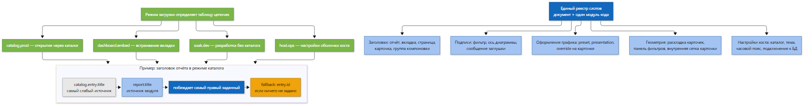

*Диаграмма 10 — цепочка источников и режимы загрузки. Источник: [`10-resolution-chain.mmd`](architecture/diagrams/10-resolution-chain.mmd).*

Проблема: одно и то же значение (заголовок карточки, тема, часовой пояс, оформление графика) может быть задано в нескольких местах. Нужен ответ на вопрос «кто побеждает».

Ответ (ADR-0057) — **единый реестр**:

* для каждого «слота» определена **цепочка** источников от слабого к сильному;
* побеждает **самый правый заданный** источник;
* если не задан никто — работает **запасное правило** (fallback);
* цепочки могут отличаться в зависимости от **режима загрузки**;

| Режим | Когда используется |
|-------|--------------------|
| `catalog.prod` | Зритель открывает отчёт через каталог |
| `dashboard.embed` | Вкладка встроена в другой отчёт |
| `soak.dev` | Разработка: файл открыт напрямую, без каталога |
| `host.ops` | Настройки оболочки: тема, каталог, хранилище настроек |

Главное: **автор не должен знать правила заранее**. Он просто пишет «как ему удобно», а платформа сводит источники по одному документированному реестру. Новый источник в языке = одна строка в цепочке, а не абзац в пяти документах.

# 8. Данные: три плоскости

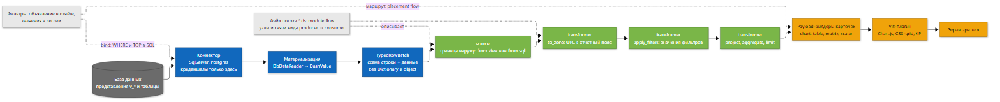

*Диаграмма 6 — Acquisition → Flow → Present. Источник: [`06-data-planes.mmd`](architecture/diagrams/06-data-planes.mmd).*

## 8.1 Разделение обязанностей

| Плоскость | Что делает | Чего не делает |
|-----------|-----------|----------------|
| **Data Acquisition** (получение данных) | Подключение к БД, выполнение SQL, таймауты, ограничение числа строк | Никаких форматов отображения |
| **Data Flow** (поток данных) | Типизированные преобразования: часовые пояса, применение фильтров, проекция колонок, агрегаты | Никаких соединений с БД |
| **Present** (представление) | Форматирование, легенды, оси, цвета, виджеты | Никакого произвольного SQL |

Логика разделения проста и объяснима словами: **тяжёлая и стабильная логика — в представлении базы данных; логика, характерная для конкретного отчёта — в преобразовании; оформление — в представлении.**

## 8.2 Типизированные строки вместо «словарей»

Раньше данные передавались как «словарь: имя колонки → значение неизвестного типа». Это быстро, но небезопасно: опечатка в имени колонки выясняется только на этапе выполнения.

Сейчас на «проводе» **типизированный пакет строк**:

* **схема строки** (`RowTypeSchema`) — объявленный тип строки: имена полей и их типы (`int`, `string`, `date`, …);
* **значение** (`DashValue`) — закрытый набор примитивов, без «чего угодно»;
* **пакет** (`TypedRowBatch`) — схема + строки с доступом по номеру поля.

Схема приходит из **модели** (объявленные типы строк), а не угадывается по результату SQL-запроса. Это позволяет ловить ошибки ещё до обращения к базе. Соответствие правил проверяют анализаторы `DSPEC030–034`.

## 8.3 Поток данных на примере

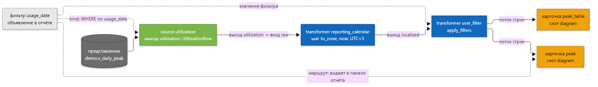

*Диаграмма 7 — пример потока: источник, преобразование, две карточки. Источник: [`07-dashflow-example.mmd`](architecture/diagrams/07-dashflow-example.mmd).*

Как это читается словами:

1. В базе есть представление `demo.v_daily_peak`.
2. Спецификация объявляет **источник** `utilization`, который читает это представление и объявляет типизированный выход.
3. **Преобразователь** `reporting_calendar` переводит время из UTC в отчётный часовой пояс.
4. **Преобразователь** `user_filter` применяет значения фильтров.
5. Одна и та же «локализованная» строка идёт в **две карточки** — то есть данные считаются один раз, а показываются дважды.

Синтаксис связей единый и читаемый: `producer [выход] -> [вход] consumer`. Стрелки, объявления узлов и блоки портов — одна и та же форма во всех местах, где в спецификации что-то соединяется. Это устраняет «раздвоение сознания», когда в одном месте данные связываются одним способом, в другом — другим.

## 8.4 Как объявление фильтра становится SQL

Фильтры **не живут в коннекторе** — это важное решение и частый источник недоразумений. Путь фильтра:

| Шаг | Где | Что происходит |
|-----|-----|----------------|
| 1 | Спецификация | `filter usage_date` с типом, колонкой, часовым поясом, значением по умолчанию |
| 2 | Карточка | Ссылка на фильтр (привязка). Раньше это называлось «bind» |
| 3 | Core/Compilation | `QueryCompiler` собирает `WHERE`, параметры, при необходимости ограничение числа строк |
| 4 | Коннектор | Выполняет готовый параметризованный запрос |
| 5 | Сессия | Хранит **значения**, а не SQL |

Важно: **значения фильтров никогда не вставляются в текст SQL** — они передаются параметрами. Это защита от подстановки SQL-кода.

## 8.5 Сценарий: зритель меняет фильтр

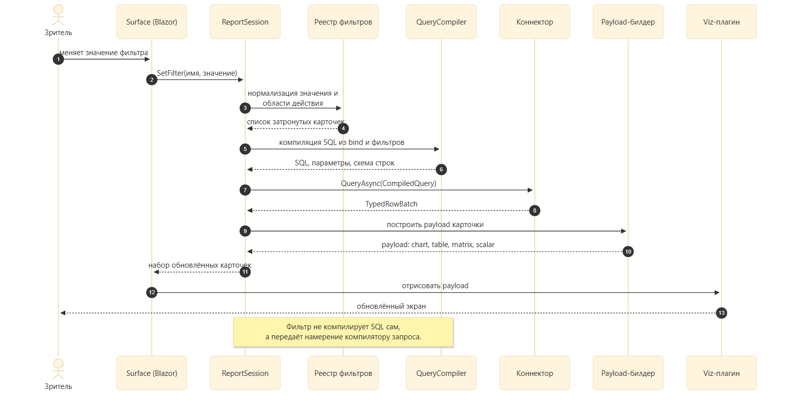

*Диаграмма 8 — что происходит при смене фильтра. Источник: [`08-runtime-sequence.mmd`](architecture/diagrams/08-runtime-sequence.mmd).*

Обратите внимание на слой абстракции: **фильтр не умеет сам ходить в базу**. Он лишь меняет состояние сессии; за перевод намерения в SQL отвечает компилятор запросов, за выполнение — коннектор, за форму данных — сборщик данных карточки, за пиксели — плагин визуализации. Каждый делает ровно одно.

# 9. Отображение и интерактивность

| Механизм | Смысл |
|----------|-------|
| **Плоскости раскладки** | Единая сетка слотов: сетка хоста и сетка карточек — это одна и та же модель. Схемы вида `[ Q W ]` задают, какие карточки в каких ячейках |
| **Панель (toolbar) как раскладка** | Та же bracket-модель, но для фильтров: где какой виджет стоит |
| **Chrome (оформление)** | Заголовок, кнопки, вкладки-переключатели представления — отдельно от содержимого карточки |
| **Ячейки и слоты внутри карточки** | Карточка может иметь несколько «окошек», например диаграмму и таблицу одновременно |
| **Клик по карточке** | Ограниченный набор действий: задать значение фильтра, перейти на другую страницу, вызвать действие плагина |
| **Плагины визуализации** | Карточка не знает, как рисовать; она знает, какой payload отдать плагину |
| **Полноэкранный режим и детализация** | Карточка умеет отдавать «крупный» payload для отдельного просмотра |

Общий принцип: **разметка и данные разделены**. Карточка получает готовые данные в предсказуемой форме, а «как это выглядит» решает подключаемый модуль отображения.

# 10. Плагинная архитектура

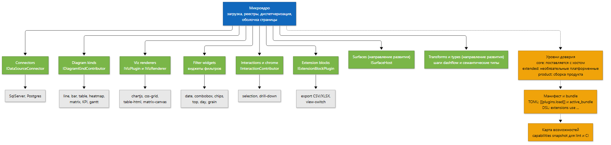

*Диаграмма 9 — микроядро и семейства плагинов. Источник: [`09-plugin-families.mmd`](architecture/diagrams/09-plugin-families.mmd).*

## 10.1 Микроядро и семейства

Система построена как **микроядро** (ADR-0033): ядро мало́ и стабильно, а всё изменчивое вынесено в **семейства плагинов**. Семейство — это общий «позвоночник» (общие контракты и вспомогательный разбор) плюс подключаемые реализации.

| Семейство | Контракт | Примеры |
|-----------|----------|---------|
| Коннекторы | `IDataSourceConnector`, `IConnectorPlugin` | SQL Server, PostgreSQL |
| Виды диаграмм | `IDiagramKindContributor` | линия, столбцы, таблица, тепловая карта, матрица, KPI, диаграмма Ганта, точечная, дерево, «роза ветров», интервальная |
| Модули отображения | `IVizPlugin`, `IVizRenderer` | Chart.js, CSS-grid, таблица HTML, холст матрицы |
| Виджеты фильтров | реестр виджетов | дата, выпадающий список, мультивыбор, «чипсы», TOP-N, гранулярность |
| Взаимодействия и chrome | `IInteractionContributor`, `ICardChromeContributor` | выделение, детализация, кнопки карточки |
| Расширяющие блоки | `IExtensionBlockPlugin` | экспорт CSV/XLSX, переключатель представлений |
| Поверхности | `ISurfaceHost` (проект) | веб, desktop, BFF |
| Преобразования и типы | (проект) | шаги dashflow, семантические типы |

## 10.2 Три уровня доверия

| Уровень | Что это | Кто отвечает |
|---------|---------|--------------|
| **core** | Поставляется вместе с хостом, нужен для эталонных примеров | Платформа |
| **extended** | Необязательные платформенные плагины | Платформа |
| **product** | Сборка продукта или заказчика | Продукт |

**Bundle** (набор) отвечает на вопрос «что загружено на конкретном развёртывании», **уровень** — на вопрос «что можно пускать в продакшн» (политика CI).

## 10.3 Загрузка и включение — разные вещи

| Фаза | Где | Смысл |
|------|-----|-------|
| **Загрузить** | манифест TOML: `[[plugins.load]]` + `active_bundle` | DLL существует и известна хосту |
| **Включить** | спецификация: `extensions { use acme-export }` | Включено для конкретного отчёта |
| **Импортировать** (только разработка) | `extensions { import … from "plugins/….dll" }` | Быстрый локальный путь без упаковки |

Такое разделение даёт предсказуемость: продукт не может случайно «включиться» сам, а платформа видит полный список возможностей (`capabilities`) для подсказок и проверок.

## 10.4 Контракт для внешних авторов (SDK)

Автор плагина не должен ссылаться на внутренности платформы. Для него существует **SDK**: только контракты, документация, шаблоны и версионирование. Правила:

* публичный контракт = `DashSpec.Abstractions` + документированный манифест;
* версия контракта меняется по семантическому версионированию;
* шаблоны проектов создают заготовку плагина «в один шаг».

# 11. Развёртывание и эксплуатация

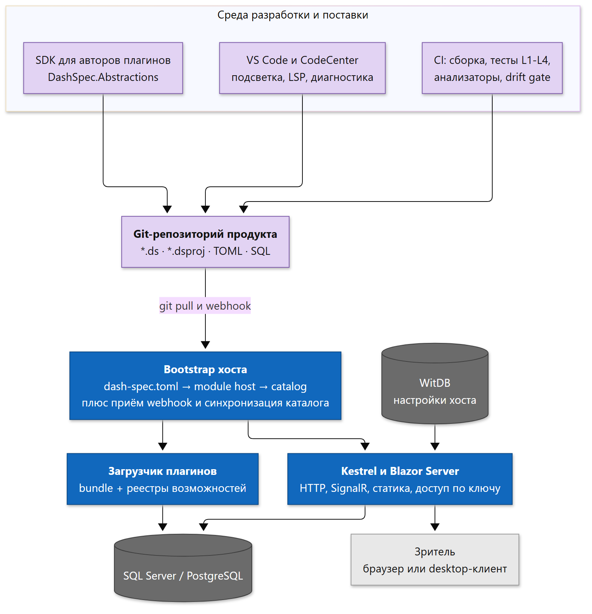

*Диаграмма 11 — что и где работает. Источник: [`11-deployment.mmd`](architecture/diagrams/11-deployment.mmd).*

## 11.1 Цепочка запуска

1. Читается `dash-spec.toml` хоста.
2. Он указывает на единицу `module host` (оболочка продукта).
3. Оболочка указывает на **каталог** отчётов (`module catalog`) — это список того, что видит зритель.
4. Публикуется точка входа; запускается веб-служба.
5. Загружаются плагины согласно bundle.
6. Зритель открывает ссылку и работает с отчётом.

## 11.2 Доступ

| Способ | Как |
|--------|-----|
| Ключ через форму | Страница доступа, ключ сохраняется в защищённую cookie |
| API и скрипты | Заголовок с ключом |
| Закладка | Ключ в адресе один раз, дальше — cookie |
| Проверка живучести | Отдельная точка без ключа — для мониторинга |

Пустой ключ означает «открытый» режим, что удобно при разработке и недопустимо в проде.

## 11.3 Синхронизация каталога

Каталог отчётов обновляется из git. Два режима: **по загрузке** (хост перечитывает репозиторий) и **по событию** (вебхук после push). Это позволяет добавлять новые отчёты обычным merge request, без ручного передела настроек.

## 11.4 Настройки хоста

Часть настроек (тема, отображаемое имя продукта, часовой пояс) хранится вне спецификаций — в хранилище настроек хоста. Это разделение важно: **спецификация описывает отчёт, а не инфраструктуру**.

# 12. Контур качества

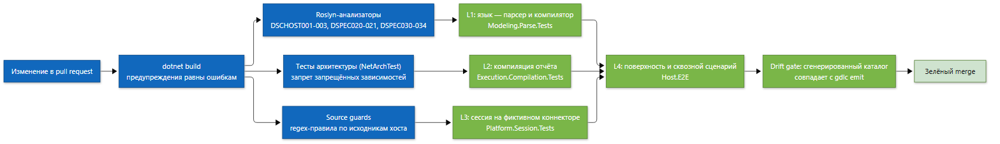

*Диаграмма 12 — автоматические проверки на каждом изменении. Источник: [`12-quality-gates.mmd`](architecture/diagrams/12-quality-gates.mmd).*

## 12.1 Проверки архитектуры

| Инструмент | Что защищает |
|-----------|--------------|
| **Roslyn-анализаторы** | Правила размещения кода: где можно считать payload, где можно работать с датами, где допустим SQL-клиент, где допустим ввод-вывод |
| **Тесты архитектуры** | Запрещённые зависимости между сборками |
| **Source guards** | Регулярные проверки по исходникам веб-хоста (в частности, запрет «зашитых» строк интерфейса вместо централизованного словаря) |
| **Предупреждения как ошибки** | Не позволяет копить долг незаметно |
| **Drift gate** | Сгенерированный каталог команд должен совпадать с генератором — иначе ручная правка «уедет» |

## 12.2 Уровни тестирования

| Уровень | Что проверяет | Нужны ли браузер и база |
|---------|---------------|--------------------------|
| **L1 — язык** | Разбор, импорт, компиляция единиц | нет |
| **L2 — компиляция отчёта** | Сборка эталонных примеров, граф проводки | нет |
| **L3 — сессия** | Поведение сессии на **фиктивном коннекторе** | нет |
| **L4 — поверхность** | Сквозной сценарий: развёртывание, страница, API | да |

Уровень L3 — самый ценный с архитектурной точки зрения: он доказывает, что **поведение платформы можно проверить без интерфейса**. Это и есть практическое доказательство того, что «платформа отделена от вьюера».

# 13. Ключевые архитектурные решения

Все решения оформлены как ADR (Architecture Decision Records) в каталоге `design/`. Ниже — те, что определяют облик системы.

| № | Решение | Суть |
|---|---------|------|
| 0001 | Коннекторы как плагины | Базы данных подключаются сборками, а не правкой ядра |
| 0009 | Фильтры только через привязку | Карточка объявляет, какие фильтры ей нужны; SQL компилируется из этого |
| 0017 | Модульность и файловые включения | Разделение спецификации на переиспользуемые единицы |
| 0023 | Каталог отчётов | Верхний уровень «что вообще есть» для зрителя |
| 0024 | Слои авторинга документа | Заголовок, окружение, конфигурация, подключение, тело |
| 0033 | Семейства плагинов и микроядро | Единая модель расширений |
| 0047 | Платформа против поверхностей | Продукт — платформа; веб-хост — лишь один из вьюеров |
| 0048 | Modeling (F#) против Execution (C#) | Разделение по природе задачи |
| 0051 | Определение языка по природе задачи | Почему жёсткая модель на F#, а механика на C# |
| 0057 | Реестр разрешений | Единая точка «кто побеждает» при конфликте настроек |
| 0074 | Хост как оболочка | Никаких навигационных догадок в интерфейсе |
| 0078–0087 | Поток данных и типизация | Плоскости данных, типы портов, типизированные строки |
| 0086 | Поверхности как плагины + BFF | Сторонний интерфейс подключается контрактом, а не форком |
| 0091–0098 | Единый граф и конвейер компиляции | Один синтаксис связей, один оркестратор фаз |
| 0099 | Разделение платформы и веб-поверхности | Контрактные тесты без браузера |
| 0101–0102 | Один вид файла, один язык | Единый `.ds`, устаревшие формы удаляются, а не поддерживаются вечно |

# 14. Сильные стороны архитектуры

## 14.1 Источник истины — текст, а не база инструмента

**Что это даёт.** Отчёт можно отревьюить построчно, посмотреть историю изменений, откатить, разобрать конфликт слияния, найти поиском по репозиторию. Работают любые инженерные практики: ветки, CI, автоматический линт, агенты.

**Почему это сильно.** Большинство BI-инструментов хранят дашборды внутри себя. DashSpec переносит определение отчёта в среду, где уже есть все инструменты зрелости. Это не «ещё одна фича», это смена базовой модели.

**Для непрограммиста.** Представьте, что вместо «настроек в личном кабинете, которые никто не помнит» регламент лежит в общей папке с историей правок и подписями, кто и что менял.

## 14.2 Чистое разделение «платформа — вьюер»

**Что это даёт.** Одну и ту же логику отчёта используют веб-браузер, desktop-редактор и (в перспективе) стороннее приложение партнёра. При этом никто не форкает ядро.

**Почему это сильно.** Это доказано не словами, а тестом: уровень L3 проверяет сессию с фиктивным коннектором и без интерфейса. Если бы логика протекла в интерфейс, такой тест был бы невозможен.

## 14.3 Один компилятор языка

**Что это даёт.** Раньше в проекте сосуществовали два разбора: на C# и на F#. Это классический источник расхождений: правят один, забывают второй. Сейчас разбор языка один; C# только **потребляет** результат.

**Почему это сильно.** Устраняется целый класс ошибок «работает в одном месте, не работает в другом» и упрощается добавление новых возможностей языка.

## 14.4 Архитектурные правила проверяются сборкой

**Что это даёт.** Направление зависимостей, запрет SQL вне коннекторов, запрет ввода-вывода в рантайме, запрет «словарей вместо типов», запрет бизнес-логики в интерфейсе — всё это **ломает сборку** при нарушении.

**Почему это сильно.** Архитектурные решения, которые «живут в документе», деградируют за полгода. Здесь деградацию физически невозможно пронести через CI незамеченной. Это самая недооценённая, но самая прочная часть решения.

## 14.5 Единая модель расширений

**Что это даёт.** Новая диаграмма, новый коннектор, новый виджет фильтра, новое действие — всё это плагин с одним и тем же контрактом, манифестом, уровнями доверия и картой возможностей.

**Почему это сильно.** Платформа может развивать «зоопарк» под потребности продукта, не выпуская новую версию ядра. При этом ядро остаётся маленьким.

## 14.6 Типизация данных до обращения к базе

**Что это даёт.** Строка имеет **объявленную схему**, а не «угаданную» по результату запроса. Опечатки в именах колонок и несоответствия типов отлавливаются на этапе проверки спецификации.

**Почему это сильно.** Ошибки данных — самая дорогая категория ошибок в аналитике: они не падают, они просто показывают неправильные числа. Схема делает такие ошибки громкими и ранними.

## 14.7 Явность вместо магии

**Что это даёт.** Реестр разрешений, композитор и «хост как оболочка» устраняют неявные правила. Всё, что показано зрителю, либо записано в спецификации, либо явно выведено композитором.

**Почему это сильно.** Поведение отчёта становится **воспроизводимым и тестируемым**: один и тот же вход даёт один и тот же результат. Скрытые правила («если элементов больше одного — показать меню») невозможно тестировать и легко сломать случайно.

## 14.8 Разделение фаз вместо «одного большого парсера»

**Что это даёт.** Пост-обработка — явный конвейер фаз. Новый вход в систему (новый вьюер, новый инструмент) получает тот же порядок обработки автоматически.

**Почему это сильно.** Экономит будущие ошибки «забыли вызвать шаг» — самый неприятный вид регрессии, потому что он проявляется не сразу.

## 14.9 Готовность к агентам и автоматизации

**Что это даёт.** Текстовая спецификация с диагностиками, индексом символов, языковым сервером и режимом проверки из командной строки хорошо подходит для автоматической правки — человеком или программным агентом.

**Почему это сильно.** Это отличает DashSpec от «BI для человека с мышкой»: система одинаково пригодна для ручного и автоматизированного авторинга.

# 15. Слабые стороны, риски и технический долг

Честный разбор. Ниже — то, что реально ограничивает систему сегодня.

## 15.1 Переходный слой `DashSpec.Core` ещё не растворён

**Суть.** Историческое ядро на C# продолжает существовать: в нём остались IR-записи и мосты к F#-парсеру. Формально задекларировано, что это временный слой, но он всё ещё в середине графа зависимостей: и `Execution.Core`, и `Execution.Runtime`, и `Execution.Compilation` зависят от него.

**Почему это плохо.** Два представления одной модели (F# и C#) требуют синхронизации. Пока оба живы, существует риск расхождения и дублирования правил.

**Что снижает риск.** Направление зафиксировано, этапы миграции пройдены (парсеры на C# удалены), а тесты уровней L1–L3 держат поведение.

**Что делать.** Довести миграцию до конца: F#-IR становится единственным источником истины, а C#-модель — проекцией на границе либо генерируемым типом.

## 15.2 Ранняя стадия (версия 0.x) и подвижность языка

**Суть.** Язык и API ядра активно меняются между минорными версиями. Только что произошёл крупный переход: единый вид файлов (`.ds`), `module <вид> <идентификатор>`, отказ от устаревших форм.

**Почему это плохо.** Продуктам приходится мигрировать спецификации; внешние интеграции нестабильны; документация местами отстаёт (например, корневой `README` ещё описывает старые расширения файлов).

**Что снижает риск.** Принцип «один язык» — устаревшие формы **удаляются**, а не поддерживаются вечно. Это уменьшает долг в будущем, но увеличивает стоимость перехода сейчас. Диагностики с позициями делают миграцию механической.

**Что делать.** Зафиксировать публичный контракт 1.0 и синхронизировать документацию с фактическим состоянием языка.

## 15.3 Платформенные файлы вне репозитория (`authoring-toolchain`)

**Суть.** Часть проверок (совпадение сгенерированного каталога команд) требует соседнего репозитория с генератором.

**Почему это плохо.** Сборка зависит от внешнего окружения; для внешнего участника воспроизводимость падает.

**Что делать.** Либо вендорить генератор, либо перенести проверку в отдельный необязательный шаг CI с явным сообщением.

## 15.4 Избыточная связность в середине платформы

**Суть.** `Execution.Compilation` зависит одновременно от `Execution.Core`, `Execution.Runtime` и переходного `Core`. Через него проходит большинство внутренних связей.

**Почему это плохо.** Такие узлы плохо поддаются параллельной разработке и точечным изменениям: правка в одной ветке часто задевает соседние.

**Что снижает риск.** Разделение по слоям и наличие контрактов; модульность парсеров.

**Что делать.** Разорвать цикл «Compilation → Runtime» выделением общего ядра сборки отчёта; сделать верхний уровень зависимостей явным (диаграмма 4a показывает это узкое место).

## 15.5 Часть деклараций «принята», но не реализована

**Суть.** Ряд решений имеет статус «принято, частично». Например, BFF-поверхность (HTTP/OpenAPI), поверхности как плагины, часть шагов dashflow (агрегаты, соединения), внешние DLL визуализаций.

**Почему это плохо.** Документация описывает целевую картину; читатель может принять заложенное за работающее.

**Что снижает риск.** Статусы ADR содержат степень готовности; в этом документе разделы §10.1 и §11 отмечают проектное состояние явно.

**Что делать.** Держать в индексе ADR отметку «реализовано / частично» (уже практикуется) и указывать это в пользовательской документации.

## 15.6 Двуязычие документации и кода

**Суть.** ADR и часть документации — на русском, идентификаторы кода — на английском, отдельные документы смешивают языки.

**Почему это плохо.** Затрудняет внешнее участие и автоматическую обработку документации.

**Что делать.** Разделить: ADR — на английском (или двуязычно), пользовательские руководства — локализованы.

## 15.7 Широта предметной области как риск размывания

**Суть.** Платформа претендует на роль «git-native BI»: язык, движок, семантический слой, каталог, вьюеры, плагины, студия. Это большая поверхность для небольшой команды.

**Почему это плохо.** Риск «широко, но неглубоко»: много начатого, мало доведённого до продуктового качества (например, полноценный внешний язык запросов отсутствует, а платформенные проверки живут вне репозитория).

**Что снижает риск.** Чёткое разделение «платформа — продукт — вьюер» и правило «проверяем вторым вьюером»: возможность объявляется доказанной только когда её переиспользует вторая поверхность.

**Что делать.** Последовательно закрывать по одной вертикали целиком (от спецификации до теста и документации), а не расширять число вертикалей.

## 15.8 Стоимость явности

**Суть.** Отказ от неявных правил («скрыть навигацию, если один элемент») увеличивает объём спецификаций и требует от автора больше решений.

**Почему это плохо.** Порог входа растёт; простые отчёты выглядят многословно.

**Что снижает риск.** Возможность задать общие значения по умолчанию на уровне отчёта (например, диапазоны фильтров) и пресеты оформления.

**Что делать.** Развивать «разумные, но записанные в артефакт» умолчания: значение по умолчанию допустимо, если оно попадает в скомпонованное представление явно.

## 15.9 Производительность и объём данных

**Суть.** Есть ограничения на число строк и таймауты запроса; тяжёлые преобразования выполняются после получения данных.

**Почему это плохо.** Отчёт «на миллионы строк» требует, чтобы агрегация была выполнена в базе. Это архитектурное ограничение, а не ошибка.

**Что делать.** Правило уже сформулировано: стабильная тяжёлая логика — в представлениях базы; преобразование — только для специфичных для отчёта задач. Нужно довести это правило до авторов как обязательную практику.

## 15.10 Унаследованные артефакты и «двойные» имена

**Суть.** В репозитории сосуществуют новые и старые имена (`.ds` и легаси-расширения, старые и новые формы блоков), переходные типы (`IReportSession` и `IReportPreviewSession`), частично перекрывающиеся реестры (визуализации и виджеты фильтров в `Viz`/`Filters`/`Viewer`).

**Почему это плохо.** Затрудняет понимание «где что лежит» и увеличивает риск, что новый участник возьмёт устаревший путь.

**Что делать.** Завершить удаление устаревших форм (заявлено в ADR-0102), убрать переходные типы после миграции продуктов.

# 16. Куда развивается архитектура

| Этап | Что появляется | Условие перехода |
|------|----------------|------------------|
| **Сейчас** | Язык, компиляция, сессия, веб-вьюер, плагины, каталог | — |
| **Ближайший шаг** | Вторая поверхность (Studio) на **той же сессии**; проверка на равенство результатов | Контрактные тесты сессии |
| **Далее** | BFF-поверхность (HTTP/OpenAPI) для SPA и партнёров | Выделенная сессия-фасад |
| **Далее** | Семантический каталог метрик (единицы измерения и метрики без повторения имён представлений в каждой карточке) | Полнота реестра разрешений |
| **Далее** | Headless-режим: выгрузка в PDF/PNG, расписание | Стабильный контракт payload |
| **В перспективе** | Реестр каталогов для нескольких арендаторов, SDK встраивания | Внешний потребитель |

Критерий зрелости, который команда применяет сознательно: **новая возможность считается доказанной только тогда, когда её переиспользует вторая поверхность**. Это защита от «архитектуры на бумаге».

# 17. Итоговая оценка

| Аспект | Оценка | Комментарий |
|--------|--------|-------------|
| **Идея и позиционирование** | Сильно | Текст как источник истины + платформа отдельно от вьюера — редкое и правильное сочетание |
| **Разделение слоёв** | Сильно | Правила закреплены сборкой, а не соглашениями |
| **Расширяемость** | Сильно | Единая модель плагинов с уровнями доверия и манифестом |
| **Работа с данными** | Сильно | Типизация до обращения к базе, SQL только в коннекторах, параметризация |
| **Тестируемость** | Сильно | Уровень L3 доказывает отделение логики от интерфейса |
| **Зрелость и стабильность** | Слабое место | Версия 0.x, активные ломающие изменения |
| **Связность середины** | Средне | Есть перегруженный узел `Execution.Compilation` и переходный `Core` |
| **Документация** | Средне | ADR подробны, но пользовательская документация отстаёт от языка |
| **Воспроизводимость сборки** | Средне | Зависимость от соседнего репозитория-генератора |
| **Широта охвата** | Риск | Большая поверхность для малой команды |

**Вывод.** Это архитектура **сильной концепции с честно признанным долгом**. Основные механизмы (единый компилятор, конвейер фаз, типизированные данные, плагинные семейства, реестр разрешений, архитектурные проверки) — зрелые и продуманные. Основные ограничения — стадия развития (0.x), незавершённая миграция переходного слоя и широта заявленного охвата. Ни одно из ограничений не является архитектурным тупиком: у каждого есть зафиксированный план.

# 18. Глоссарий

| Термин | Что означает простыми словами |
|--------|-------------------------------|
| **ADR** | «Запись об архитектурном решении»: короткий документ «контекст → решение → последствия». Служит памятью проекта |
| **Payload (полезная нагрузка)** | Готовые данные для одной карточки: числа, подписи, серии — в форме, которую понимает модуль отображения |
| **IR (промежуточное представление)** | Внутренняя структура, описывающая разобранный текст: «документ, у него вкладки, у вкладки карточки…» |
| **Модуль / единица компиляции** | Один файл `*.ds` с заголовком `module <вид> <имя>` |
| **Композитор** | Часть платформы, собирающая из спецификации итоговое описание экрана без догадок |
| **Коннектор** | Подключаемый модуль доступа к базе данных |
| **Микроядро** | Маленькое ядро, вокруг которого всё остальное — подключаемые модули |
| **Плагин** | Подключаемая сборка, расширяющая систему в рамках одного из «семейств» |
| **Плоскость (plane)** | Крупная зона ответственности: получение данных, преобразование, представление |
| **Проект (`*.dsproj`)** | Файл, описывающий состав пакета спецификаций |
| **Реестр разрешений** | Таблица правил «какой источник сильнее» при конфликте настроек |
| **Сессия отчёта** | Состояние работающего отчёта: значения фильтров, загруженные данные, готовые карточки |
| **Слот** | «Окошко» в карточке или ячейка раскладки, куда подаются данные |
| **TypedRowBatch** | Пакет строк данных с объявленной схемой |
| **Вьюер / поверхность (surface)** | То, что показывает отчёт: браузер, desktop, встраивание |
| **Drift gate** | Проверка «сгенерированный файл совпадает с генератором» |
| **Bundle** | Набор плагинов, загружаемых на конкретном развёртывании |
| **dashflow** | Способ описания потока данных: источники, преобразования, связи |
| **Chrome** | Оформление вокруг содержимого карточки: заголовок, кнопки, переключатели |

# 19. Как пересобрать диаграммы и DOCX

```powershell
# 1. Диаграммы: Mermaid → SVG + PNG
#    основной путь — mermaid-cli:  npm install -g @mermaid-js/mermaid-cli
#    запасной путь — публичный Kroki + Chrome/Edge и доступ в интернет
python docs/architecture/render-diagrams.py

# 2. Документ: Markdown → DOCX с нативным оглавлением Word
pwsh -File docs/architecture/make-docx.ps1
```

Исходники диаграмм лежат в `docs/architecture/diagrams/*.mmd` и являются **источником истины**: правки вносятся в них, изображения пересобираются скриптом. Настройки вёрстки диаграмм — `docs/architecture/diagrams/mermaid-config.json`.
